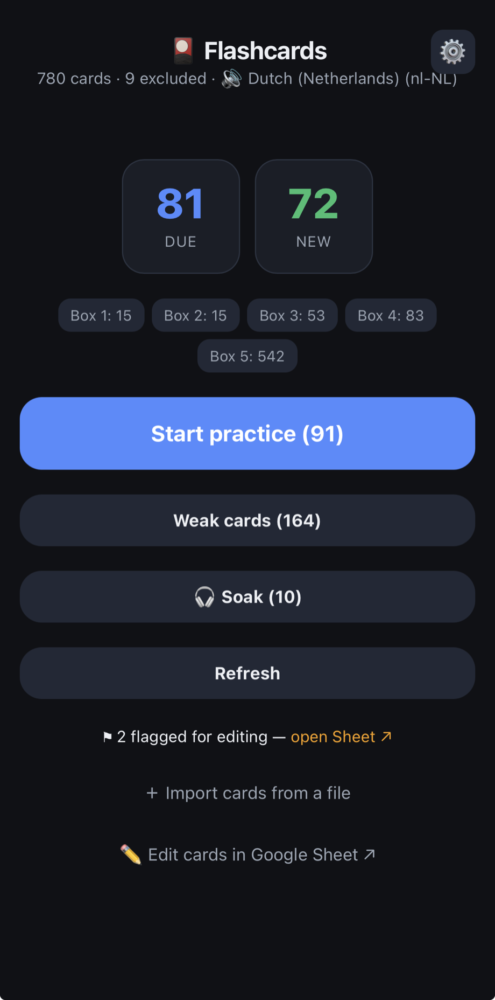
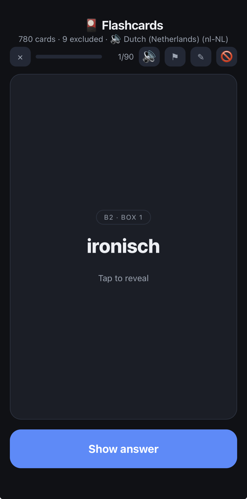

# 🎴 Flashcards

A mobile-first flashcard web app backed by a **Google Sheet**. Practice any deck
with simple **Leitner** spaced repetition, on your phone, tablet, or laptop. Card
text supports **Markdown**. No server to host and no database to run — the Google
Sheet *is* the database, and Google Apps Script serves the app.

- **Backend:** a Google Sheet (`cards` tab). Add/edit cards from anywhere.
- **App:** a single Apps Script web app (mobile-first, add-to-home-screen friendly).
- **Scheduling:** Leitner boxes (1→7), with immediate write-back of your progress.
- **Speech:** tap 🔊 to hear a word or example in the language you're studying —
  your browser's own voices, no API key, no cost.
- **🎧 Soak:** keep whole sentences in a `sentences` tab and have the app read
  them aloud one after another, with a silence between — for absorbing tempo,
  tense and clause order rather than testing yourself.
- **In-app tools:** edit a card, flag it for later, or exclude a bad card — all
  saved straight to the Sheet.
- **✨ AI assist:** have an AI write the answers on cards you haven't filled in
  yet or have flagged as wrong — with **no API key**, using whatever AI you
  already have, and a before/after preview of every card. It can also turn the
  words you keep missing into a paragraph to read. See
  [Filling cards with AI](#filling-cards-with-ai-).

> This repo is a **template** — deploy your own copy against your own Google
> account and Sheet (see below). It ships with a small Dutch A1/A2 starter deck,
> but the app is language-agnostic: set `target_language` in the `config` tab and
> it's a Chinese (or French, or Japanese) app instead. Use it for anything.

**📋 [Example Sheet — make a copy to get your own][example-sheet]** (Dutch A1/A2
starter deck, app code included). Copying it is the fastest way to start: you get
the Sheet *and* the app in one click, no CLI. See [Deploy your own](#deploy-your-own).

[example-sheet]: https://docs.google.com/spreadsheets/d/1XH4yAlpc0ahMKJP1JFcWsIpR_ATThbHTC9qAmDSiDoc/copy

## Screenshots

<p align="center">
  
  &nbsp;&nbsp;
  
</p>

## Why this instead of a flashcard app?

- **Lightweight — it's just a web page.** Nothing to install or update; it runs
  in the browser you already have, on any device (phone, tablet, laptop). No
  app-store download, no account for yet another service, no sync engine to trust.
- **No ads, no upsells — ever.** Because you self-host it (your own Apps Script
  web app + your own Google Sheet), there's no company in the middle with a
  reason to show you ads, gate features behind a subscription, or mine your
  study data. It's yours end to end.
- **Your browser's superpowers come for free.** Since it's a normal web page,
  you can **select any word to look it up, translate, or search**, use
  right-click / long-press actions, share a card, or use any browser extension
  or accessibility feature you rely on — none of which a locked-down native app
  lets you do.
- **Flexible, dead-simple editing.** Your cards live in a **Google Sheet**, so
  you can bulk-**import** a deck, tweak wording, fix a typo, add rows, or
  reorganize columns whenever you want — from the Sheet on any device, or from
  inside the app while you study. No proprietary format, no export/re-import
  dance; the spreadsheet *is* the database.
- **Bring your own AI, or none.** The AI help is a prompt you copy and a reply
  you paste back, so it works with the chat subscription or local model you
  already have — there is no API key to buy, no AI billing attached to your
  cards, and nothing is sent anywhere unless you paste it there yourself. Skip
  it entirely and the app is unchanged.
- **Quiet by design — no notifications, no gamification.** It will never buzz
  your phone with reminders you're already drowning in, and there are no
  streaks, badges, XP, or leaderboards engineered to keep you hooked. It simply
  shows what's due and gets out of the way. It runs on *your* motivation — not
  manufactured guilt or dopamine loops.

## Deploy your own

Two ways to get your own copy. Either way it ends up **entirely yours** — your
Sheet, your script, your Google account. Nothing reports back here except an
optional, anonymous once-a-day version check — see
[Updates](#updates--the-version-check) for exactly what it sends and how to
turn it off.

### Option A — copy the example Sheet (no CLI) — recommended

A Google Sheet copy includes its bound Apps Script project, so this gets you the
deck *and* the app in one step. You need only a Google account.

1. **[Make a copy of the example Sheet][example-sheet]** — this lands a
   *Flashcards* Sheet in your own Drive, starter deck and code included.
2. Make the copy yours: in the **`config`** tab, clear the **`webapp_url`** cell
   so the app resolves to *your* own deployment instead of the original's.
   (Optional: to wipe the starter progress and study from scratch, clear the
   `box`, `due`, `last_seen`, `right`, `wrong` and `flag` columns in the `cards`
   tab.)
3. Open **Extensions → Apps Script**.
4. Click **Deploy → New deployment**, choose type **Web app**, set *Execute as*
   **Me** and *Who has access* **Only myself**, then **Deploy**.
5. **Authorize** when prompted. It's your own script now, so the "Google hasn't
   verified this app" warning is expected — click *Advanced → Go to Flashcards*.
6. Open the web-app URL it gives you. On iOS, tap **Share → Add to Home Screen**
   for an app-like icon.
7. Studying something other than Dutch? Set **`target_language`** in the
   **`config`** tab (see [Settings](#settings-config-tab)).

The starter deck comes with the copy, so there is nothing to load. To start from
an empty deck instead, clear the rows under the header in the `cards` tab. (To
get the starter deck back later, import
[`decks/starter-dutch.csv`](./decks/starter-dutch.csv) — see
[Adding your own cards](#adding-your-own-cards).)

### Option B — deploy from this repo with clasp

Choose this if you want the code in git and plan to change it.

> **Using a coding agent?** See [`AGENTS.md`](./AGENTS.md) — it walks the same
> deploy split into agent-runnable commands and the three browser steps Google
> requires you (the human) to do: `clasp login`, enabling the Apps Script API,
> and the first-run authorization. The manual steps below are the human version.

You'll need [Node.js](https://nodejs.org) and a Google account.

1. **Install clasp** (Google's Apps Script CLI) and log in:
   ```bash
   npm install -g @google/clasp
   clasp login
   ```
   Also enable the Apps Script API for your account at
   <https://script.google.com/home/usersettings>.

2. **Create a Sheet-bound script project** (do this in a clone of this repo):
   ```bash
   clasp create --type sheets --title "Flashcards" --rootDir .
   ```
   This creates a new Google Sheet + bound script and writes a local
   `.clasp.json`. Note: `clasp create` overwrites `appsscript.json` with a
   default — restore this repo's version afterward (it sets the web-app access
   and timezone).

3. **Push the code and deploy as a web app:**
   ```bash
   clasp push --force
   clasp deploy --description "v1"
   ```
   The `deploy` command prints a deployment ID; your web-app URL is
   `https://script.google.com/macros/s/<DEPLOYMENT_ID>/exec`.

4. **Use it:** open the web-app URL and authorize when prompted — it's your own
   script, so the "unverified" warning is expected. The first load creates the
   empty `cards` and `config` tabs. On iOS, tap **Share → Add to Home Screen**
   for an app-like icon.

5. **Load the starter deck (optional):** in the Sheet, select the `cards` tab,
   then **File → Import → Upload** → `decks/starter-dutch.csv` from your clone.
   Import location **Replace current sheet** (the CSV brings its own header
   row), and **"Convert text to numbers, dates, and formulas" → No**. Then
   **🎴 Flashcards → Check Sheet health** confirms the import left the tab and
   column names intact.

To redeploy after changes, reuse the same deployment ID so the URL (and your
Home Screen icon) stays stable:
```bash
clasp push --force
clasp redeploy <DEPLOYMENT_ID> --description "..."
```

### Access model
Set the web app's access in `appsscript.json` (`webapp.access`):
`MYSELF` (only you — every browser must be signed into the owning account),
`ANYONE` (anyone with a Google account), or `ANYONE_ANONYMOUS` (anyone with the
link). The app always runs as the deploying user and only ever touches that
user's own Sheet.

## How to use it

- Home shows **Due** / **New** counts and the Leitner box breakdown, with the
  scheduled session on top and two free drills below it:
  - **Start practice** — the scheduled Leitner session. Grading **saves your
    progress** to the Sheet. It leads with everything due in **boxes 1 and 2**
    (the two mixed together, so it never opens on a wall of box 1), then carries
    on up the ladder. **New cards** come after that block — at most **10 a
    day**, and only if box 1 has fallen below **20 cards** by then; while the
    shaky pile is that big, no more are added to it. The whole day is capped at **80 cards**
    (`daily_limit`), counting everything you've already graded today, so a
    backlog arrives in day-sized pieces instead of all at once.
  - **Weak cards** — a free drill of the cards you keep missing (never-right ones
    first, then the shaky ones; drawn by weighted random, so the most urgent come
    up most often but the whole pool eventually cycles through).
  - **Today's mistakes** — the cards you got wrong in today's scheduled session,
    for a quick second pass while it's still fresh. It appears only on a day you
    have actually missed something.

  - **🎧 Soak** — not cards at all: your `sentences` tab, played aloud. See
    [Soak](#soak--listening-to-whole-sentences-).

  Both drills are **schedule-neutral: grading does *not* change any card's box or
  due date** — use them as often as you like without disturbing your schedule. Tap
  **Keep going** on the summary to pull a fresh batch of the same drill.
- Each card shows the **front** first. Tap it (or **Show answer**) to reveal the
  **back** + any **notes**. Revealing also speaks the example aloud — see
  [Hearing your cards](#hearing-your-cards-).
- Grade yourself:
  - Normal card: **Wrong** (back to box 1) or **Correct** (up one box).
  - Brand-new card: **Didn't know** (box 1) or **Already knew** (skip to box 4).
- In a scheduled session, progress saves to the Sheet immediately after each grade.
  In either drill, nothing about the schedule is written — which also means a card
  stays on **Today's mistakes** for the rest of the day even after you re-drill it
  correctly.
- The **✎ edit / ⚑ flag / 🚫 exclude** tools save straight to the Sheet in **both**
  modes (they change a card's content, not its schedule).

### Card tools while you practice
Each card has four tools in the progress row (top right):

- **🔊 Speak** — hear the card in the language you're studying. Works before or
  after revealing (after, it reads the example sentence too).
- **✎ Edit** — edit the card's front / back / notes (Markdown) and **Save to
  Sheet** — written back immediately. Works on phone and laptop.
- **⚑ Flag** — one tap marks the card (writes `⚑` to its `flag` column) so you
  can fix it later without stopping to type. Tap again to un-flag. Filter the
  `flag` column in the Sheet to find flagged cards — or let
  [✨ AI assist](#filling-cards-with-ai-) rewrite them for you.
- **🚫 Exclude** — drops a bad/low-quality card from all future practice
  (soft-delete: writes `x` to its `exclude` column) and skips to the next card.
  Reversible — clear the `exclude` cell to bring it back, or filter that column
  to bulk-delete those rows when cleaning up.

## The Sheet schema (`cards` tab)

| column | meaning |
|--------|---------|
| `id` | any unique value — a label for you, never used by the app (cards are found by row) |
| `type` | optional tag/category (e.g. `vocab`, `grammar`) — shown on the card badge |
| `front_side` | front of the card — **Markdown** |
| `back_side` | back of the card (the answer) — **Markdown** |
| `notes` | optional hint shown under the answer — **Markdown**. Yours, not the AI's: a fill never writes one and clears it by default |
| `box` | Leitner box 1–5. **Leave blank = new card** |
| `due` | next review date `YYYY-MM-DD` (managed by the app) |
| `last_seen`, `right`, `wrong` | stats (managed by the app) |
| `added` | date reference (your own) |
| `flag` | holds `⚑` when flagged in the app for later editing |
| `exclude` | holds `x` when excluded from practice (soft-delete) |

The app self-heals the schema: on first load it adds any missing columns
(`flag`, `exclude`) without touching your data. It does the same for the
[`config`](#settings-config-tab) and [`sentences`](#soak--listening-to-whole-sentences-)
tabs, so all three appear on their own.
Self-healing only fills *empty* header cells — it never overwrites a wrong
label. If you suspect an import or edit broke the layout, run
**🎴 Flashcards → Check Sheet health** in the Sheet: it reports exactly which
tab or column names don't match what the app expects.

Deleting rows leaves gaps in `id`, and hand-added rows often have none at all.
**🎴 Flashcards → Renumber id column** rewrites the column as 1, 2, 3 … in row
order (it asks first). Progress is untouched — the app never looks at `id` — but
the old numbers are gone, so run it only when nothing outside the Sheet still
refers to a card by its id.

### Adding your own cards
Add a row to the `cards` tab (laptop or phone). Fill `front_side`, `back_side`,
optionally `type` and `notes`. **Leave `box`/`due` empty** so it appears as a
new card. You can hand-tune proficiency any time by editing `box` and `due`.

Or write only the word, leave `back_side` blank, and have
[✨ AI assist](#filling-cards-with-ai-) write the answer for you — a card with
no answer yet is exactly what it looks for.

To bulk-add a whole deck from a CSV, tap **✏️ Edit or import cards in the Sheet**
on the home screen — it walks you through Google Sheets' own **File → Import** (a
laptop/desktop step; the Sheets mobile app can't import). The one setting that
matters there is **“Convert text to numbers, dates, and formulas” → No**, or
Google turns entries like `1/2` into dates.

Ready-made decks live in [`decks/`](./decks): `starter-dutch.csv` (the deck the
example Sheet ships with), `starter-chinese.csv` (basic Mandarin vocab +
grammar), and `starter-arabic.csv` (first Modern Standard Arabic words, with
transliteration). After importing the Chinese or Arabic one, set
`target_language` to `zh-CN` or `ar-001` in **⚙ Settings** so the right voice
reads your cards.

### Markdown
`front_side`, `back_side`, and `notes` render Markdown: `**bold**`, `_italic_`,
`==highlight==`, `` `code` ``, `# headings`, `- bullet lists`, `1.` numbered lists,
`[links](https://…)`, and ``. A highlight adds no horizontal
space, so it can mark part of a word in a cursive script — `==ب==اب` colours just
the first letter of باب without breaking the join. Put line breaks in a cell with **Alt+Enter**
(Option+Enter on Mac) inside the Google Sheet.

## Settings (`config` tab)

Most of these you can change **right in the app** — tap the **⚙** in the top-right,
pick your language (the list is built from the voices your device actually has),
speed and auto-speak, and Save. No need to touch the Sheet.

Under the hood they live in a second tab called **`config`**, as `key` / `value`
rows, so you can also edit a cell and reload. The tab is created automatically with
sensible defaults the first time the app runs, so there's nothing to set up.

| key | default | what it does |
|-----|---------|--------------|
| `target_language` | `nl-NL` | **The language you're studying.** A [BCP-47](https://en.wikipedia.org/wiki/IETF_language_tag) tag — `zh-CN`, `fr-FR`, `de-DE`, `es-ES`, `ja-JP`… |
| `native_language` | `English` | **The language you think in.** AI explanations and translations come back in it. A plain name (`English`, `Nederlands`, `中文`), not a tag — nothing speaks it. Also in **⚙ Settings**. |
| `speech_rate` | `0.9` | Speaking speed. `0.5` = slow, `1` = normal. |
| `auto_speak` | `yes` | Speak the example automatically when you reveal an answer? `yes` / `no` |
| `sentence_gap` | `1.5` | Seconds of silence after each sentence in **🎧 Soak**. `0` = no pause. Also in **⚙ Settings**. |
| `sentence_repeat` | `1` | How many times **🎧 Soak** speaks each sentence before moving on. Also in **⚙ Settings**. |
| `daily_limit` | `80` | Most cards one **day** will serve you, across however many sittings — cards you already graded today count against it. `0` = no limit. Also in **⚙ Settings**. |
| `box1_new_gate` | `20` | New cards wait while box 1 holds this many or more. Raise it to meet new words sooner, lower it to clear the shaky pile first. `0` = never introduce new cards. Sheet-only. |
| `update_check` | `yes` | Check for app updates on startup? Sends one anonymous ping a day — see [Updates](#updates--the-version-check). Also in **⚙ Settings**. `yes` / `no` |
| `ai_endpoint` | Google's Gemini URL | Where the Sheet's **AI assist** menu sends a card. Gemini only — see [Filling cards with AI](#filling-cards-with-ai-). The app's own route uses no endpoint. Sheet-only. |
| `ai_model` | `gemini-flash-latest` | Which Gemini model that menu asks. Ignored when `ai_endpoint` already names one in its path. Sheet-only. |
| `webapp_url` | *(blank)* | The `/exec` link of your deployment, used by **🎴 Flashcards → Open the app ↗**. Blank = auto-detect. |

## Filling cards with AI ✨

Keeping a deck is mostly a writing job: a card needs a gloss, maybe a register
note, an example sentence worth hearing. **✨ Fill cards with AI** on the home
screen does that writing for the cards that need it, and
**✨ Make a paragraph from my mistakes** turns the words you keep missing into
something to read.

Both are optional, both are off until you tap them, and neither sends anything
anywhere by itself.

### Which cards qualify

The ✨ row appears on the home screen only when there is something for it to do,
and says what it found. Two kinds of card count:

- **No answer yet** — a new card (blank `box`) with an empty `back_side`. Type a
  word into the Sheet, leave the rest blank, and it becomes a target.
- **Flagged** (`⚑`) — you tapped ⚑ while practising because the answer was
  wrong, thin, or missing its example.

What gets written, and nothing else:

| column | when |
|--------|------|
| `back_side` | always — this is the field being asked for |
| `front_side` | only on a card that is **still new**, and only if the AI returns one |
| `notes` | **cleared**, unless you keep them |
| `flag` | **cleared**, unless you keep the flags |

`box`, `due`, `last_seen`, `right` and `wrong` are never touched, so **no card's
schedule moves**: a fill never costs you a review or hands back a card you had
already learned.

Two of those rows are deliberate:

- **Flags and notes are cleared.** Both are your mark that a card needed work,
  and the work has just been done — left in place, the card would come back as
  a target forever. Two tick boxes in the preview keep either one for the whole
  batch.
- **A studied card's front is left alone.** A blank `box` means you have never
  been asked this card, so tidying its prompt (an article to strip, a typo)
  costs nothing. Once you have been retrieving against that exact prompt,
  changing it would alter what you've been practising rather than improve it —
  so a new front is ignored there.

### The app's route — copy out, paste back, read the preview

This is the route that needs no API key, no endpoint and no extra account:
**you** are the connection to the AI.

1. **Copy the prompt.** Tap the ✨ row on the home screen. It lists up to 40 of
   your cards and asks for the answers back as JSON. Nothing leaves your phone
   at this step.
2. **Paste it into whatever AI you have** — a chat subscription, a model running
   on your own machine, anything with a text box — and copy the reply.
3. **Paste the reply back and read the preview.** Every card is shown with its
   old answer and the new one, your own note in full, and a tick box. **Untick
   anything you would rather not take**: it keeps the answer it has, keeps its
   flag, and is still a target next time. Then press **Write *n* cards**.

Parsing the reply is deliberately forgiving, because the text has been through a
chat window — a code fence, a line of commentary, an array or an object keyed by
card number all work. The one thing it can't do without is the **card number**
on each answer, because that's what addresses the row.

Nothing is written until you press the button, and what gets written comes only
from the reply you pasted.

### The Sheet's route — automatic, with a Gemini key

**🎴 Flashcards → AI assist → Fill in new + flagged cards** does the same job
without you in the middle, by calling Google's Gemini API with a key of your
own. It's the quicker route for a big batch, and **it has no preview** — it
writes each answer as it arrives. Setting it up:

1. **AI assist → Set the API key…** with a key from
   <https://aistudio.google.com/apikey>. It goes into the script's own
   properties, **not** into a config cell: a Sheet gets copied, exported and
   shared, and a key in a cell travels with it. (The flip side — a copy of your
   Sheet starts with no key and sets its own.)
2. **The endpoint and model** are the `ai_endpoint` / `ai_model` config rows,
   and the defaults need no editing. **Gemini only**, on purpose: every API has
   its own request shape, its own way of carrying the key and its own way of
   reporting a refusal, so each extra provider is a code path that can only be
   tested on its own — and Gemini is the one with a free tier, which is what
   matters if you haven't bought anything.
3. **AI assist → Test the connection** — one cheap round-trip that names the
   key, endpoint, model or format problem if there is one.

> **A chat subscription is not an API key.** Gemini Advanced — like Claude Pro
> or ChatGPT Plus — doesn't include API access; that has its own key, with its
> own free tier. If you have a subscription and no key, the app's route above is
> the one that works with it.

One card is one request, and each is written as its answer arrives, so a failure
costs that card and nothing else. Apps Script gives a menu action about six
minutes, so a run stops at 15 cards or four minutes and reports what's left —
run it again to carry on.

> This is the only part of the app that makes an outside request, so it needs a
> scope the earlier versions didn't — if you updated an existing copy, the next
> menu action asks you to authorize the script once more. Expected, once.

### ✨ A paragraph from your mistakes

Drilling shows a word on its own, which is not how anyone ever meets one.
**✨ Make a paragraph from my mistakes** collects the words you've been getting
wrong and builds one prompt asking for a short paragraph that uses all of them.

It is **copy-only**: there's no paste-back step, nothing is written to any tab,
and no card is touched. You read the paragraph wherever you pasted the prompt.

Pick the window — **Today**, **Last 7 days**, or **All time** (everything still
unmastered that you've missed at least once) — and the panel shows all three
counts, so you can see which one has something in it. Up to 20 words, worst
first, so a long list loses its least troublesome end.

Each word goes in **with its gloss** (`verdom — to flatly refuse`), taken from
the first line of its answer. That isn't padding: an AI handed a bare list of
foreign words quietly guesses at the ones it half-knows, and a paragraph that
uses your word wrongly is worse than no paragraph — you'd be practising the
mistake.

The prompt asks for the practised words in `_italics_` with a translation
underneath, which is this app's own convention (see
[Hearing your cards](#hearing-your-cards-)). So a paragraph that comes back in
that shape can be pasted straight into the [`sentences`](#the-sentences-tab) tab
and **🎧 Soak** will read the right half of it. Nothing automates that — it
just fits.

## Hearing your cards 🔊

Tap **🔊** in a card's tool row to hear it, and the example sentence plays
automatically when you reveal an answer (turn that off with `auto_speak`).

### Speech
Speech uses your browser's built-in voices — nothing is sent anywhere, there's no
API key, and it costs nothing. **Only the language you're studying is ever spoken:**
the `front_side`, plus any *italic* example sentences in `back_side` / `notes`. Your
own-language gloss (the **bold** part) stays silent — you don't need it read to you.
So write cards with a **bold gloss** and an _italic example_ and speech does the
right thing on its own.

> **Set `target_language` first.** It ships as `nl-NL` because the starter deck is
> Dutch. If your cards are in another language, change it — a Dutch voice handed
> Chinese cards can't pronounce a single character and just says *"punt"* ("dot").
> The home screen always shows what it's set to (**🔊 Dutch (nl-NL)**), and the app
> refuses to speak rather than produce nonsense if the two obviously disagree.

> **Voice quality is your device's, not the app's.** iPhone and iPad are good out of
> the box, and *Settings → Accessibility → Spoken Content → Voices* lets you download
> a higher-quality voice for your language. On macOS, add voices in *System Settings →
> Accessibility → Spoken Content*. If nothing is installed for your language the app
> tells you instead of speaking it in the wrong voice.

## Soak — listening to whole sentences 🎧

Some sentences are worth hearing over and over even when you understand every
word in them: that's how the **tempo** of a language, its tenses, and the order
things go in a subordinate clause stop being rules and start being reflexes.
Cards can't do that — they ask you a question. **🎧 Soak** just plays.

Tap **🎧 Soak** on the home screen and press **▶**. It reads one sentence, goes
quiet for a moment, reads the next, and keeps going. Nothing is revealed, graded,
or written back — replay it as often as you like.

- **⏮ / ⏭** step between sentences; **tap the sentence** to hear it again.
- **🔀** shuffles, and toggles back to the order they sit in the Sheet.
- The **pause length** and **how many times each sentence repeats** are in
  **⚙ Settings** (`sentence_gap` / `sentence_repeat`).

> **Keep the app in front while it plays.** Phones suspend browser speech the
> moment the screen locks or you switch apps — that's the platform, not the app.
> Soak keeps the screen awake while it runs, and if you do switch away it pauses
> itself so you come back to where it stopped instead of to silence. It is not
> background audio.

### The `sentences` tab

Created automatically on first load, next to `cards` and `config`. Add a row per
sentence:

| column | meaning |
|--------|---------|
| `id` | any unique value — a label for you, never used by the app |
| `text` | the sentence — **the only column that is ever spoken**, so it must be in the language you're studying — **Markdown** |
| `note` | your translation, or the thing to notice (a tense, a clause order). Shown on screen, **never read aloud** — **Markdown** |
| `tag` | optional label (`perfectum`, `bijzin`, …) — shown as a badge |
| `added` | date reference (your own) |
| `exclude` | holds `x` to drop the sentence from the player |

Soak speaks `text` in the same **`target_language`** your cards are read in —
there's one study language per Sheet, so there is nothing extra to set up.

## Scheduling (Leitner)

- Boxes **1→7**, review intervals **1, 2, 4, 8, 16, 32, 64 days**. The two long
  boxes keep a mature deck from drowning in reviews: a few hundred cards parked
  in a 16-day box means dozens of repetitions a day forever, however well you
  know them.
- Each due date is scattered by up to **±15%** (`BOX_JITTER`), so a big study day
  doesn't come back as one wall exactly one interval later — the cohort fans out
  a little more every time it's seen.
- **Correct** → up one box. **Wrong** → back to box 1.
- A session runs in three stages: **boxes 1-2 first**, then **new cards** if the
  gate below opens, then **boxes 3-7**. Each stage is ordered by weakness (box
  ascending, then accuracy, then oldest due), drawn from that ranking by
  weighted random pick so the order varies run to run, and dealt out interleaved
  (`BOX_FRONT_LOAD`) — so box 1 and box 2 alternate through the opening block
  instead of arriving in one wall, and the mature boxes do the same in the tail.
- **New cards are gated twice.** First on the day: **10 new cards a day**
  (`NEW_PER_DAY`), counted from the cards whose first-ever grade was today, so
  coming back for a second or third sitting doesn't start the allowance over.
  Then on the weak pile (`box1_new_gate`, default 20): when the box-1/box-2
  block is done, the app recounts box 1 from the grades you just gave — a box-1
  card answered right has left box 1, a box-2 card missed has just joined it —
  and plays the new cards only if that count is under the gate. Clear your weak
  cards and you earn new ones; keep missing them and you aren't handed more.
  The threshold is a config row, so you can move it without touching the code.
- **At most 80 cards a day** (`daily_limit`, `DAILY_LIMIT`), not per session:
  whatever you graded earlier today is already spent, so two sittings share one
  budget. When it's used up the home screen says so; the two drills and
  **🎧 Soak** stay open, because they never write to your schedule. Set
  `daily_limit` to `0` for no limit.
- Both drills — **Weak cards** and **Today's mistakes** — are **schedule-neutral**:
  they never change a card's box or due date. Up to **20 cards** per weak drill,
  and up to **50** for a day's mistakes (a day rarely comes near that).
- Tune in `Code.js`: `BOX_INTERVALS`, `BOX_JITTER`, `MASTERED_BOX`,
  `NEW_PER_DAY`, `PRIORITY_BOX`, `SESSION_MIX_SCALE`, `BOX_FRONT_LOAD`,
  `KNOWN_START_BOX`, `PRACTICE_LIMIT`, `ERROR_DRILL_LIMIT`. `BOX1_NEW_GATE` and
  `DAILY_LIMIT` are only the fallbacks for the `box1_new_gate` and `daily_limit`
  config rows — change those in the Sheet instead.

## Updates & the version check

Your copy never updates itself — you own the code, and nothing changes unless
you change it. The version you're running is shown at the bottom of **⚙
Settings** in the app, and in the Sheet's **🎴 Flashcards → About Flashcards**
menu. Once a day the app asks this project's endpoint whether a newer version
exists. If so, the home screen shows a small
**⬆️ Update available** link to [`UPGRADE.md`](./UPGRADE.md), which walks you
through updating in a couple of minutes (your cards and progress are never
touched).

That request is also the project's only usage signal — it's how the author
knows roughly how many people use the app. Full disclosure of what it involves:

- **What's sent:** the app version and an unrecognizable fingerprint of your
  copy — a one-way hash of its spreadsheet id, so two pings can be recognized
  as the same copy but the copy itself can't be identified. That's all.
- **What's not sent:** nothing about you or your deck — no account, no email,
  no card contents, no study data. The endpoint is an Apps Script web app,
  which doesn't even expose callers' IP addresses to its owner.
- **How to turn it off:** untick **Tell me when an update is available** in
  **⚙ Settings** (or set `update_check` to `no` in the `config` tab). You'll
  stop seeing update hints, and no ping is ever sent.

## Project files

| file | purpose |
|------|---------|
| `Code.js` | backend: `doGet`, Leitner logic, sheet I/O, the `getSession`/`getWeakCards`/`gradeCard`/`updateCard` API, and the `ai*` functions behind [AI assist](#filling-cards-with-ai-) |
| `Index.html` | the entire UI — inline CSS/JS + a small Markdown renderer |
| `decks/` | starter decks as plain CSV — load one via **File → Import** (see [Adding your own cards](#adding-your-own-cards)) |
| `appsscript.json` | Apps Script manifest (timezone + web-app access) |
| `.claspignore` | limits what clasp pushes to the script |
| `UPGRADE.md` | how to update your copy when a new version is out |
| `.claspignore.public`, `push-public.sh` | maintainer-only: sync this repo to the [example Sheet][example-sheet]'s script. Not needed to run or deploy the app — ignore them in your own copy. |
| `collector/` | maintainer-only: the endpoint behind the version check. Never pushed to app copies — ignore it in your own copy. |

## License

[MIT](./LICENSE).
